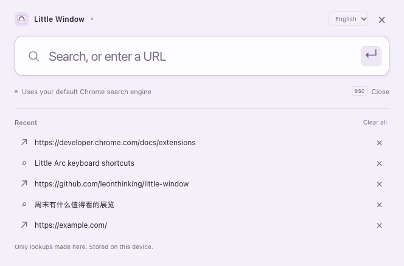

# Little Window · 小窗

A small Chrome window for a quick look at the web. Search, browse, close, and get back to what you were doing.

[简体中文](README.zh-CN.md) · [Privacy](PRIVACY.md) · [Test coverage](docs/TESTING.md) · [MIT License](LICENSE)

Inspired by the convenience of Little Arc. Independent project; not affiliated with Arc, The Browser Company, or Google.

## Features

- Open a focused search box from the extension toolbar, options page, or a user-assigned global shortcut.
- Submit a URL or use your configured Chrome search engine. Results stay in the same independent popup window.
- English and Simplified Chinese, with automatic browser-language detection and a manual language selector.
- The last **five lookups submitted through Little Window**, stored locally. Replay, remove one, or clear all. Repeated lookups move to the top.
- Remember the search window and browsing window's position and size separately. Windows fit into the launcher's current available display area.
- Light and dark appearance, keyboard navigation, and IME composition handling.
- No runtime dependencies, telemetry, server, website access, or content injection. Only `search` and `storage` permissions.



## Install

Requires Chrome 116 or later.

1. Download `little-window-0.2.0.zip` from [Releases](https://github.com/leonthinking/little-window/releases), then unzip it to a permanent folder.
2. Open `chrome://extensions` and enable **Developer mode**.
3. Click **Load unpacked**, then select the extracted `little-window` folder containing `manifest.json`.
4. Use **Try the window** on the welcome page, or pin and click the extension icon.

You can also clone this repository and load its root folder directly; there is no build step. Updating an unpacked installation requires replacing its files and clicking **Reload** in `chrome://extensions`. Your local extension settings persist when the installation path and extension identity remain unchanged.

### Optional global shortcut

Open `chrome://extensions/shortcuts`, find Little Window, choose an available combination, and select **Global**. New installations assign **no default shortcut** to avoid collisions. Existing user bindings remain managed by Chrome.

Chrome must remain running. System, browser, and other app shortcuts can take priority. Global commands are not supported on ChromeOS. This feature is separate from Chrome's native **Search from desktop** shortcut; choose different combinations if using both. See [Chrome's Commands API](https://developer.chrome.com/docs/extensions/reference/api/commands).

## Use

- Enter a query or `example.com`, a full HTTP(S) address, an internationalized domain, or `localhost:3000`.
- Press Enter to submit. Enter used to confirm IME candidates does not submit.
- Escape or × closes the search box. On a webpage, use the native window close button or **⌘W** on macOS / **Ctrl+W** on Windows and Linux. Webpage Escape remains available to the website.
- Calling Little Window again focuses an unsubmitted search box; after submission it opens a new search box while existing browsing windows remain.
- Use the language selector on either page. The extension name shown by Chrome follows Chrome's own UI locale; the selector changes Little Window's pages.
- Resize or move either kind of window normally. Minimized, maximized, and fullscreen bounds do not replace the last ordinary bounds.

History means the five accepted submissions, not Chrome's entire history and not every link followed within a browsing window. A URL accepted by Chrome counts even if the destination later fails to load. History is not synchronized to other devices. Incognito use is disabled. See [Privacy](PRIVACY.md).

## Compared with Chrome's native desktop search

| | Chrome Search from desktop | Little Window |
|---|---|---|
| Entry | Native desktop search / menu bar | Extension toolbar / optional global command |
| After submitting | A normal browser tab | The same independent popup becomes the webpage |
| Lookup list | Native omnibox suggestions | The extension's last five lookups, locally removable |
| Window preference | Controlled by Chrome | Separate remembered launcher and browsing bounds |
| Appearance | Chrome's native interface | Compact lavender interface, EN/ZH, light/dark |
| Best fit | Getting quickly to a normal Chrome tab | A brief lookup beside your current work |

Native behavior above was checked against Chromium **156.0.8078.48**, particularly [`OmniboxEverywhereService::OpenUrl`](https://chromium.googlesource.com/chromium/src/+/156.0.8078.48/chrome/browser/ui/omnibox/omnibox_everywhere_service.cc). Availability and behavior can change as Chrome ships the feature.

## Limitations

Chrome's native window frame remains. Little Window does not implement an Arc-style titlebar, external-link interception, automatic archiving, search suggestions, or a custom toolbar over websites. Closing a popup does not clear normal Chrome history or website data. It uses the current profile's existing website login state.

Window placement uses the display reported by the launcher without requesting display-management permissions. A remembered browsing position on a different display is clamped to the launcher's display. Native display, Spaces, focus restoration, window-manager constraints, and shortcut conflicts remain controlled by Chrome and the operating system. See the explicit tested and untested boundaries in [Test coverage](docs/TESTING.md).

## Development

Node.js 22+, Python 3 (ZIP packaging), and npm are needed only for development:

```sh
npm ci
npx playwright install chromium
npm test
npm run test:e2e
npm run package
```

On Linux, install browser system dependencies with `npx playwright install --with-deps chromium`. To use an existing compatible testing Chromium build, set `CHROME_EXECUTABLE_PATH` to its executable. Tests create a temporary profile, serve only a local fixture, intercept default-search navigation, and remove the temporary profile afterward. They never use your daily Chrome profile or register a global key.

The ZIP in `dist/` includes only runtime files, icons, translations, license, and privacy text. Development dependencies and browser profiles are excluded. GitHub Actions runs the same unit and browser suites.
