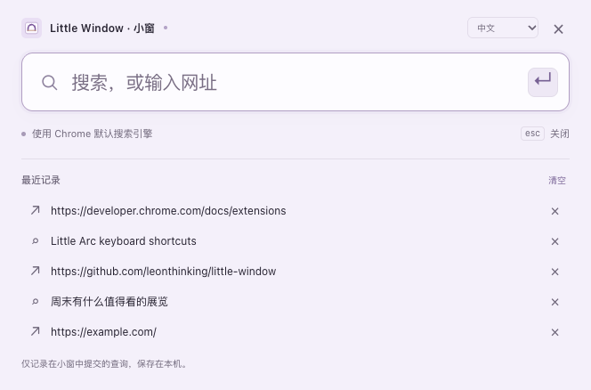

# Little Window · 小窗

随手查一下，然后继续手边的事。一个纯 Chrome 插件：呼出搜索框，在独立小窗中浏览，看完即关。

[English](README.md) · [隐私说明](PRIVACY.md) · [测试覆盖](docs/TESTING.md) · [MIT 开源许可证](LICENSE)

灵感来自 Little Arc 的便利体验。本项目与 Arc、The Browser Company、Google 无隶属关系。

## 这版包含什么

- 工具栏图标、引导页按钮或自行设置的全局快捷键呼出搜索框。
- 输入网址或关键词，用 Chrome 默认搜索引擎，在同一个独立小窗里浏览。
- 中英双语：自动跟随浏览器，也可手动选择中文 / English。
- 插件内最近 **5 次查询**，本机保存；重复查询置顶，可点击重开、单条删除、一键清空。
- 搜索框与网页小窗分别记住最近的普通状态位置和大小，重新打开时恢复。
- 深浅色外观、键盘操作、中文输入法选词保护。
- 仅申请 `search`、`storage` 权限，无服务器、无追踪、无网页内容访问权限。



## 安装

需要 Chrome 116 或更新版本。

1. 在 [Releases](https://github.com/leonthinking/little-window/releases) 下载 `little-window-0.2.0.zip`，解压到固定位置。
2. Chrome 打开 `chrome://extensions`，开启「开发者模式」。
3. 点击「加载已解压的扩展程序」，选择含 `manifest.json` 的 `little-window` 文件夹。
4. 点击欢迎页「试用小窗」，或将插件固定到工具栏后点击图标。

也可以克隆仓库，直接加载仓库根目录，无需构建。更新时替换原目录内文件，然后在扩展管理页点击「重新加载」；安装路径和插件身份不变时，本地设置会保留。

### 可选：设置全局快捷键

打开 `chrome://extensions/shortcuts`，找到 Little Window，设置可用的组合键，作用范围选择「全局」。为避免占用已有按键，新安装不预设快捷键。已安装版本的用户绑定由 Chrome 管理。

Chrome 必须保持运行；系统、浏览器和其他应用可能优先处理某些按键。ChromeOS 不支持全局命令。插件快捷键与 Chrome 原生「Search from desktop」独立；两者并用时应选不同组合。[Chrome 官方说明](https://developer.chrome.com/docs/extensions/reference/api/commands)

## 日常使用

- 支持关键词、`example.com`、完整 http/https 地址、中文域名、`localhost:3000`。
- 回车提交；中文输入法选词的回车不会提前打开网页。
- 搜索框按 Esc 或 × 关闭；网页使用原生关闭按钮，或 macOS 的 **⌘W** / Windows、Linux 的 **Ctrl+W**。网页内 Esc 留给网站使用。
- 尚未提交时再次呼出会聚焦现有搜索框；提交后再次呼出则新开搜索框，已打开的网页小窗保留。
- 两个页面都能切换语言。Chrome 扩展列表中的名称跟随 Chrome 自身语言；手动选择影响插件页面。
- 拖动、调整窗口后自动保存普通状态尺寸。最小化、最大化、全屏不会覆盖普通尺寸。

「历史」仅指插件接受的最近 5 次提交，不是整个 Chrome 的历史，也不记录小窗内之后点击的链接。网址被 Chrome 接受后，即使网站稍后加载失败，也算一次提交。记录不同步到其他设备。无痕模式禁用。[完整隐私说明](PRIVACY.md)

## 与 Chrome 原生搜索的区别

| | Chrome 原生桌面搜索 | Little Window |
|---|---|---|
| 打开入口 | 原生搜索框、菜单栏 | 插件图标、可选全局快捷键 |
| 提交后 | 打开普通浏览器标签页 | 在同一个独立小窗中浏览 |
| 查询记录 | Chrome 原生地址栏建议 | 仅插件最近 5 次，可删除 |
| 窗口记忆 | 由 Chrome 控制 | 搜索框、网页小窗分别记忆 |
| 界面 | Chrome 原生样式 | 浅紫色界面，中英与深浅色 |
| 适合场景 | 快速进入日常 Chrome 标签页 | 查一眼资料，看完关闭小窗 |

原生行为对照基于 Chromium **156.0.8078.48** 的 [`OmniboxEverywhereService::OpenUrl`](https://chromium.googlesource.com/chromium/src/+/156.0.8078.48/chrome/browser/ui/omnibox/omnibox_everywhere_service.cc)。该功能的开放范围和后续行为可能变化。

## 已知边界

小窗仍有 Chrome / 系统原生标题栏。没有实现 Arc 自定义标题栏、接管外部链接、自动归档、实时联想或覆盖网页的自定义工具栏。

小窗使用当前 Chrome 用户配置及网站登录状态，正常产生浏览历史。关闭小窗、清空插件记录都不等于无痕浏览，也不会清除 Chrome 的历史或网站数据。

窗口恢复使用搜索框所在显示器的可用区域，不申请显示器管理权限。网页位置若原本在另一块屏幕，会被限制到搜索框所在屏幕。Spaces、焦点返回、系统尺寸限制及按键冲突仍由 Chrome/macOS 控制。已验证与未验证范围列在[测试说明](docs/TESTING.md)，不承诺所有系统组合均无冲突。

## 开发与验证

开发环境需要 Node.js 22+、npm；打包 ZIP 需要 Python 3。

```sh
npm ci
npx playwright install chromium
npm test
npm run test:e2e
npm run package
```

Linux 可用 `npx playwright install --with-deps chromium` 安装系统依赖。已有兼容测试浏览器时，通过 `CHROME_EXECUTABLE_PATH` 指定其可执行文件。

端到端测试使用临时独立用户配置和本机测试网页；默认搜索请求被拦截验证参数，不向真实搜索服务发送测试词。不会使用日常 Chrome 用户配置或录入全局快捷键。`dist/` 的 ZIP 仅含运行文件、图标、翻译、许可证及隐私文本，不含开发依赖、测试浏览器数据。GitHub Actions 执行相同验证。
